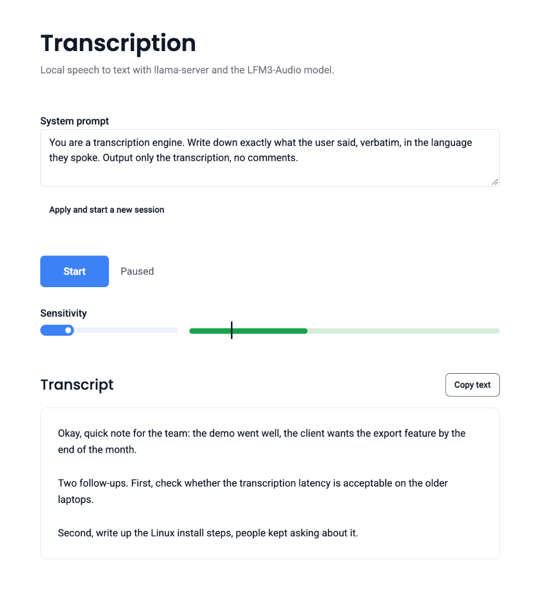

# Transcription – LFM3-Audio

Browser-based speech-to-text client. The microphone is captured in the browser, a simple voice activity detector (VAD) splits the audio into utterances and sends them over WebSocket to a local `llama-server` running the LFM3-Audio model, which returns the transcription.

Stack: Vue 3, Vite, Tailwind CSS 4, daisyUI 5 (theme based on [Clean](https://www.typeui.sh/design-skills/clean)).



## Requirements

- macOS or Linux
- Node.js ≥ 20 and npm
- Chrome (AudioWorklet, microphone access)

## Install

### macOS

```sh
brew install llama.cpp
npm install
```

### Linux

[Homebrew on Linux](https://docs.brew.sh/Homebrew-on-Linux) works the same way:

```sh
brew install llama.cpp
npm install
```

Without Homebrew, either download a prebuilt `llama-server` from the [llama.cpp releases](https://github.com/ggml-org/llama.cpp/releases) (pick the archive for your CPU or GPU, unpack it and put `llama-server` on your `PATH`), or build from source:

```sh
sudo apt install build-essential cmake libcurl4-openssl-dev   # Debian/Ubuntu
git clone https://github.com/ggml-org/llama.cpp
cmake -S llama.cpp -B llama.cpp/build -DCMAKE_BUILD_TYPE=Release
cmake --build llama.cpp/build --target llama-server -j
sudo cp llama.cpp/build/bin/llama-server /usr/local/bin/
npm install
```

`libcurl` is required for the `-hf` flag that downloads the model from Hugging Face. For NVIDIA GPUs add `-DGGML_CUDA=ON` to the first `cmake` command.

## Run

```sh
npm start
```

One command starts `llama-server` with the LFM3-Audio model on port `9931` and the Vite dev server, then opens the app in the browser. Ctrl+C stops both. On the first run the model (about 1.5 GB) is downloaded from Hugging Face, so the "Ready" status appears only after a few minutes; until then the app shows a connection error and reconnects automatically every 2 seconds.

Separately:

```sh
llama-server -hf LiquidAI/LFM3-Audio-2B-GGUF:Q4_K_M --port 9931
npm run dev
```

The app connects to `ws://localhost:9931/v1/realtime`; change the port or host in `src/useTranscriber.js` (`WS_URL`). The microphone works without HTTPS because the page is served from `localhost`.

Production build: `npm run build`, output in `dist/`.

## Usage

1. Wait for the status "Ready – click Start".
2. Click **Start** and allow microphone access.
3. Speak. After about 0.8 s of silence the utterance is sent and shortly appears as a paragraph in the "Transcript" section.
4. The **Sensitivity** slider sets the loudness threshold; the black mark on the level bar shows the threshold against the current signal. If transcription starts on background noise, raise the threshold; if quiet speech is missed, lower it.
5. **Copy text** copies all paragraphs to the clipboard.
6. **Apply and start a new session** sends the edited system prompt and clears the text. The model context grows with every utterance, so start a new session now and then during long dictation.
